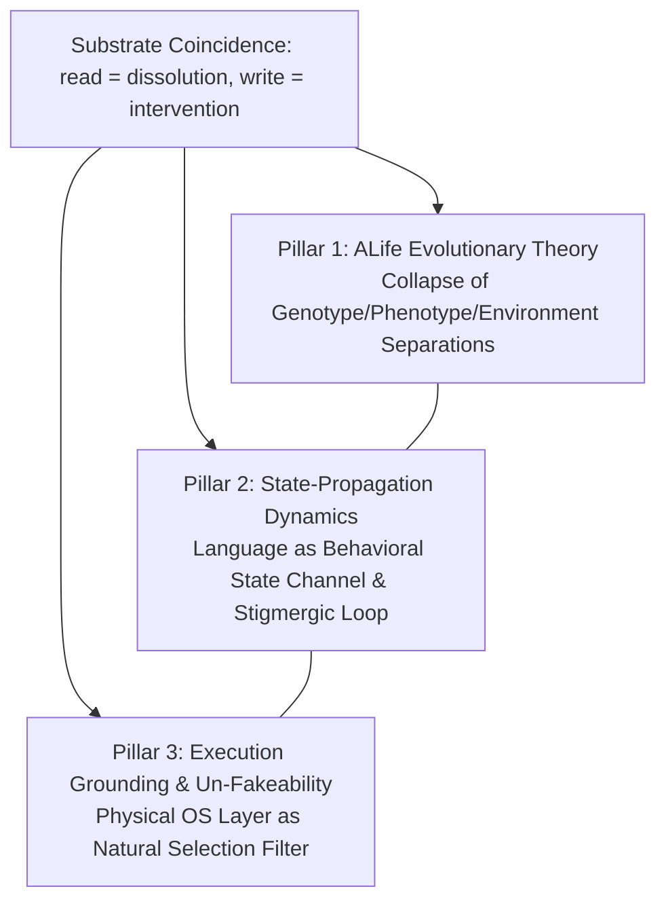

# Substrate-Coincidence Theory: Three Paper Directions

## What this is

The substrate-coincidence theory (read = dissolution → one medium on both
sides of every boundary) is a single theoretical root that now supports
**three distinct paper projections**, each with its own audience, venue,
central claim, and owned evidence. This file is the family index: it names
the three, draws the boundaries between them, and prevents them from
collapsing back into one overloaded manuscript.

The three are non-overlapping **only if each respects its scope**. Material
that belongs to another direction is routed there, not duplicated here.

## Shared root (one paragraph)

A persistent language-mediated agent system is one where LLM agents run as
OS processes over a shared filesystem workspace, read files losslessly into
their context window, and write artifacts that persist for later readers.
On this substrate, `read = dissolution` (lossless absorption of environment
into cognition, not translation) and `write = latent future intervention`
(persistence is unfiltered at the write layer). Each of the three papers
foregrounds a different consequence of this same root.

## The three directions

| # | Direction | Audience | Venue | Central claim (one line) | Home |
|---|---|---|---|---|---|
| 1 | **ALife substrate-coincidence theory** | ALife / evolutionary theory / cultural evolution | arxiv (alife) → ALIFE journal | Three evolutionary separations collapse simultaneously due to read = dissolution; OEE criteria are substrate-contingent | [`./alife-theory/manuscript-draft.md`](alife-theory/manuscript-draft.md), [`./alife-theory/README.md`](alife-theory/README.md) |
| 2 | **State-propagation** | AI/ML-core / multi-agent systems / LLM agents | AAMAS / Archival | Persistent LLM agents propagate state through language artifacts via a path-dependent feedback loop; the workspace is a behavioral state channel, not passive memory | [`./aaai-state-propagation/`](aaai-state-propagation) |
| 3 | **exec-unfakeable / spec-gaming cure** | AI safety / specification gaming / reward hacking | Archival | OS-execution as an endogenous population-level selection pressure that resists narrative specification gaming; the inter-agent epistemic cut | [`../../../incubator/aaai-c1-exec-unfakeable-writeup.md`](../../incubator/aaai-c1-exec-unfakeable-writeup.md) |

## Unified Monograph Architecture: Three Synergistic Pillars

The three branches form a coherent, integrated theoretical monograph on Substrate Coincidence. Rather than existing as walled-off or mutually exclusive fragments, each pillar illuminates a vital dimension of the same foundational physics:

| Pillar | Focus | Core Contribution to the Monograph |
|---|---|---|
| **1. ALife Substrate-Coincidence Theory** | Evolutionary ontology & OEE | Resolves how lossless textual absorption collapses the three classical biological separations and reframes open-ended evolution for computational substrates. |
| **2. State-Propagation Dynamics** | Inter-agent cognitive transmission | Formalizes the operational dynamics of read/write lineages, demonstrating that shared workspace files act as active behavioral state channels. |
| **3. Execution Grounding & Un-Fakeability** | Physical constraint & selection | Grounds language-mediated communication in un-fakeable OS execution, proving that physical state transitions resolve narrative specification gaming. |

### Monograph Synthesis & Convergence

The three pillars directly reinforce each other in the unified monograph:
- **Theory to Dynamics:** Pillar 1's ontology of substrate coincidence provides the foundational justification for Pillar 2's state-propagation models.
- **Dynamics to Physical Grounding:** Pillar 2's language-mediated feedback loops are anchored by Pillar 3's execution barrier, ensuring that propagated state corresponds to verified functional capability rather than hollow narration.
- **Unified Whole:** Together, the pillars present a complete, multi-scale account of how computational autopoiesis, communication, and evolution operate when cognitive processing and environmental media share the same language substrate.

## Direction maturity

| # | Status |
|---|---|
| 1 | Draft complete (~16k words); in peer-input phase ([`./alife-theory/NEXT-PHASE.md`](alife-theory/NEXT-PHASE.md)) |
| 2 | Frozen rewrite basis; pre-draft, paused, venue-unbound ([`./aaai-state-propagation/DOSSIER.md`](aaai-state-propagation/DOSSIER.md)) |
| 3 | Theory backbone now in [`../unfakeable-selection`](../unfakeable-selection/README.md) (seed-dossier, 2026-06-29, from the 5-lens Finding 1); the empirical exec-arm is still gated on the hollow-payload pilot |

## Writing discipline: instrument vs subject on projection

The canonical rule lives at the Paper level:
[`../../../projection-principles.md`](../../projection-principles.md) §
*Instrument-vs-Subject Framing on Projection*. Summary: unless a section is
explicitly about a specific Quine mechanism, any Quine-runtime-specific
detail that does not generalize or does not serve the paper's central claim
is cut; Quine is introduced once as the instrument, phenomena are described
in class-level language.

### Family-specific instantiation (recorded 2026-06-25, from the AAAI reframe)

- **Kept (class-level):** verbatim lossless re-entry of a written block into
  a later reader's context; behavioral convergence through shared
  coordination files; endogenous goal uptake from others' writes;
  the `exec` barrier as the physical execution-grounding layer.
- **Demoted to instrument color:** fork fold-back (`unfold` /
  subagent anchor inheritance); the commit-conversion event (kept as
  the abstract `promote(·)` durability layer in the formal model);
  named shell-script tools (folded into "cross-run artifact reuse," unnamed).

The ALife theory direction is exempt in proportion to how central
Quine-as-subject is to its three-collapse claim; even there, mechanism
detail not serving the argument is prunable.

## Source surfaces

- Theory object: [`../../../theory/objects/substrate-coincidence.md`](../../../theory/objects/substrate-coincidence.md)
- Experimental basis (shared): [`../../../../experiments/active/null-ecology/null-05-reflexive-self-embedding/`](../../../experiments/active/null-ecology/null-05-reflexive-self-embedding)
- AAAI-27 venue card: [`../../../venues/objects/aaai-27.md`](../../venues/objects/aaai-27.md)
- AAAI candidate scan (incubator): [`../../../incubator/quine-native-aaai-candidates.md`](../../incubator/quine-native-aaai-candidates.md)
- Un-fakeable-selection theory backbone (Finding 1, 2026-06-29): [`../unfakeable-selection/README.md`](../unfakeable-selection/README.md)
- Substrate-coincidence valence challenge (Finding 2, gated review): [`../../../incubator/substrate-coincidence-valence-challenge.md`](../../incubator/substrate-coincidence-valence-challenge.md)
- Multi-lens collision provenance (8 lenses, 40 candidates): [`../../../theory/references/multi-lens-collision-2026-06-29.md`](../../../theory/references/multi-lens-collision-2026-06-29.md)

---

*Maintained as the family control plane. When a direction changes scope,
update its ownership row here before editing the direction's own home.*
